<div align="center">


<br />
<br />


<br />

<sub>

**[Manifesto](#-manifesto)** &nbsp;✦&nbsp; **[Galeria](#-galeria)** &nbsp;✦&nbsp; **[Por dentro](#-por-dentro)** &nbsp;✦&nbsp; **[Rodando](#-rodando-localmente)** &nbsp;✦&nbsp; **[Deploy](#-deploy)** &nbsp;✦&nbsp; **[Créditos](#-créditos)**

</sub>

</div>

<br />

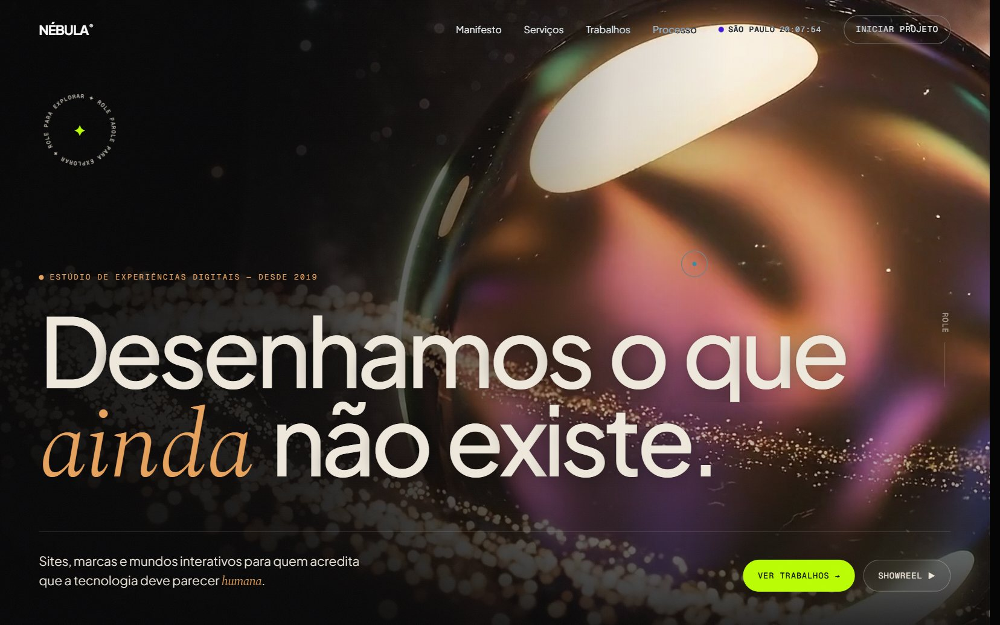

<br />

## ✦ Manifesto

> *Acreditamos que cada interface é um pequeno universo.*
> *Ela deve respirar, reagir e lembrar de quem a toca.*

**NÉBULA** é o site de um estúdio fictício de experiências digitais em São Paulo. É um projeto de vitrine que mostra até onde a web pode ir sem nenhum framework, só HTML, CSS e JavaScript, com um **orbe de vidro líquido em WebGL**, rolagem cinematográfica e microinterações em cada canto.

As referências foram [Future Human](https://www.future-human.de/), [Mapa do Astro](https://www.mapadoastro.com.br/) e [Squared Media](https://www.squared-media.nl/). Os valores de movimento (curvas, durações e pesos de carregamento) foram extraídos do código desses três sites e reinterpretados, não copiados.

<br />

<table>
<tr>
<td width="33%" valign="top">

### ◐ &nbsp;Vivo
Orbe 3D com deformação por *simplex noise*, reflexo iridescente e um disco de **7 mil partículas** que orbitam em velocidade kepleriana.

</td>
<td width="33%" valign="top">

### ◑ &nbsp;Fluido
Rolagem suave com Lenis, títulos revelados letra por letra, cortina de abertura com a curva `(.76, 0, .24, 1)` e troca de tema escuro ↔ creme.

</td>
<td width="33%" valign="top">

### ◒ &nbsp;Cuidadoso
Responsivo de 375px a 4K, respeita `prefers-reduced-motion`, funciona sem a cena 3D e tem menu acessível por teclado.

</td>
</tr>
</table>

<br />

## ✦ Galeria

<table>
<tr>
<td width="50%">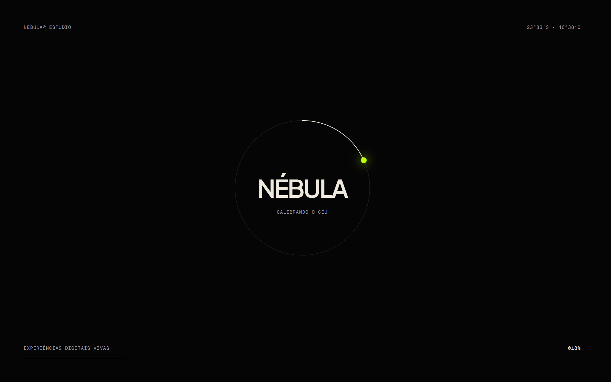<br /><sub><b>00 · Abertura</b>: anel orbital ligado ao carregamento real</sub></td>
<td width="50%">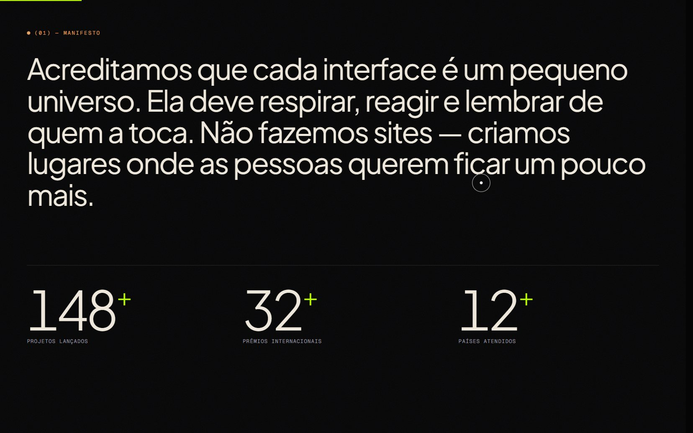<br /><sub><b>01 · Manifesto</b>: palavras que acendem com a rolagem</sub></td>
</tr>
<tr>
<td width="50%">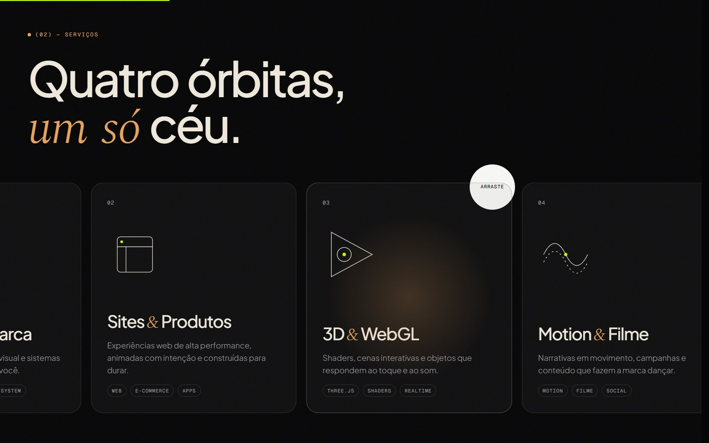<br /><sub><b>02 · Serviços</b>: cartões em trilho horizontal fixado</sub></td>
<td width="50%">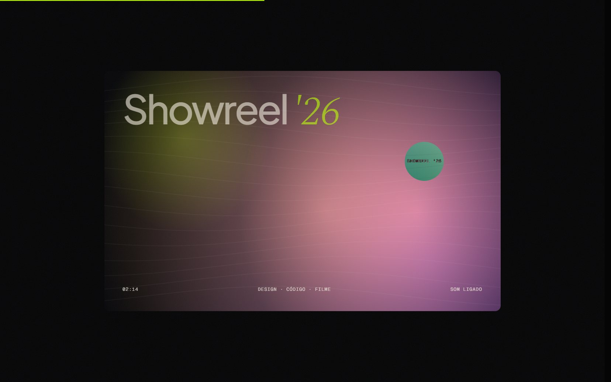<br /><sub><b>· Showreel</b>: o card cresce até ocupar a tela</sub></td>
</tr>
<tr>
<td width="50%">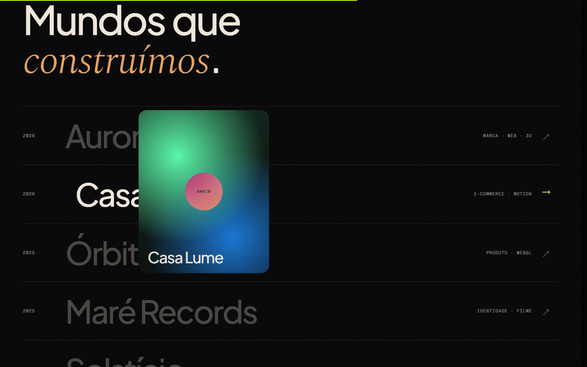<br /><sub><b>03 · Trabalhos</b>: prévia que segue e inclina com o cursor</sub></td>
<td width="50%">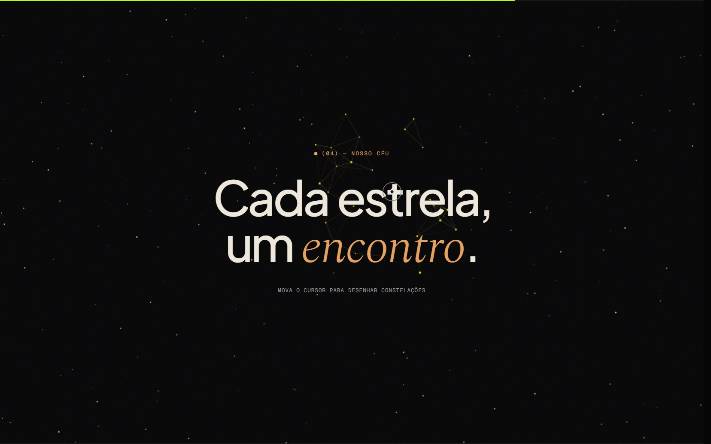<br /><sub><b>04 · Céu</b>: constelações desenhadas pelo cursor e estrelas cadentes</sub></td>
</tr>
<tr>
<td width="50%">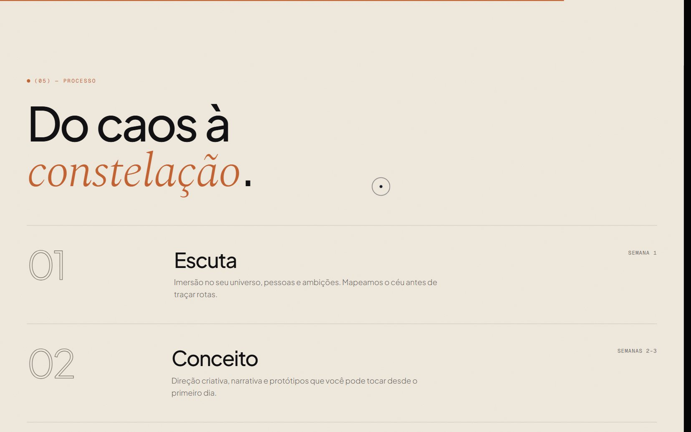<br /><sub><b>05 · Processo</b>: a página inteira muda para o tema creme</sub></td>
<td width="50%">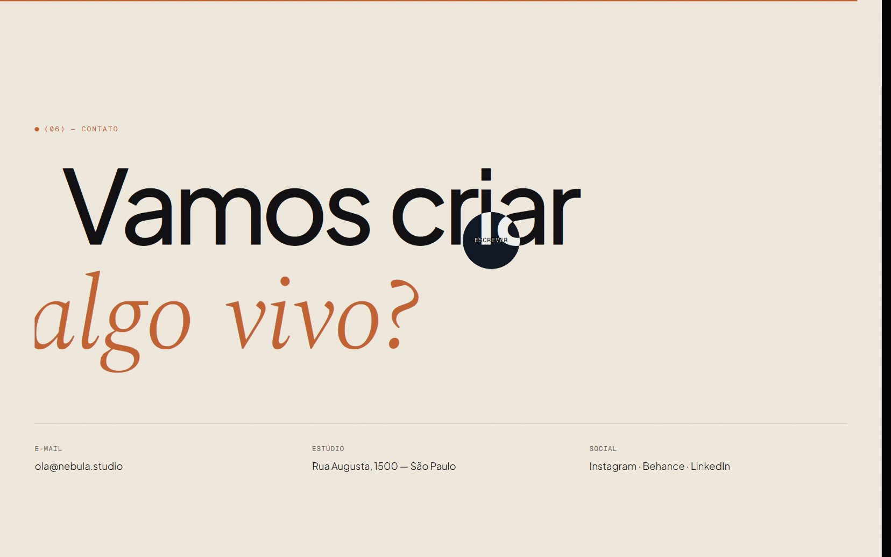<br /><sub><b>06 · Contato</b>: letras do rodapé com peso que reage ao cursor</sub></td>
</tr>
</table>

<div align="center">
<table>
<tr>
<td align="center">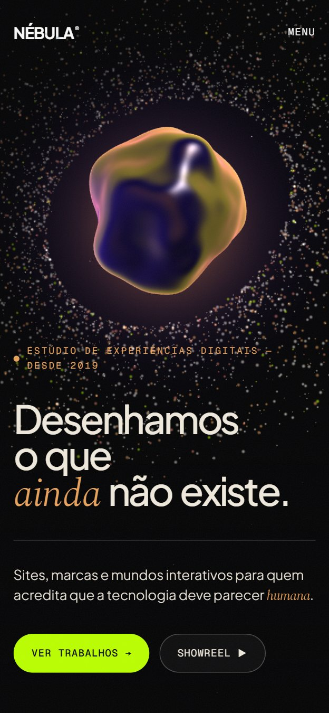<br /><sub><b>Mobile</b> · hero</sub></td>
<td align="center">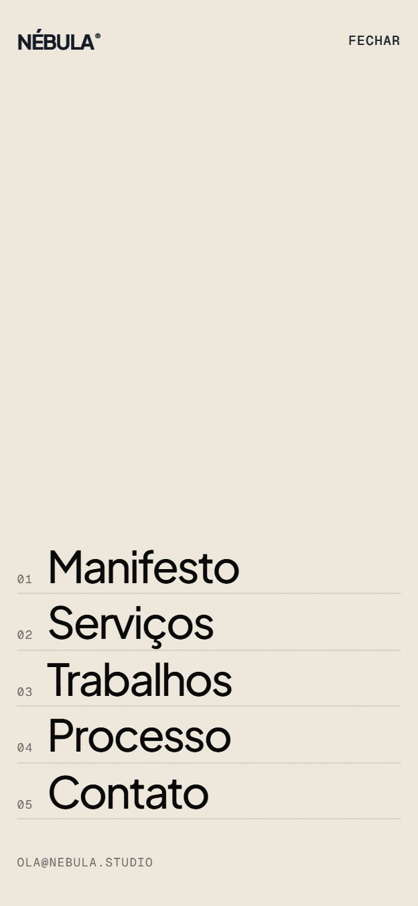<br /><sub><b>Mobile</b> · menu em tela cheia</sub></td>
</tr>
</table>
</div>

<br />

## ✦ Por dentro

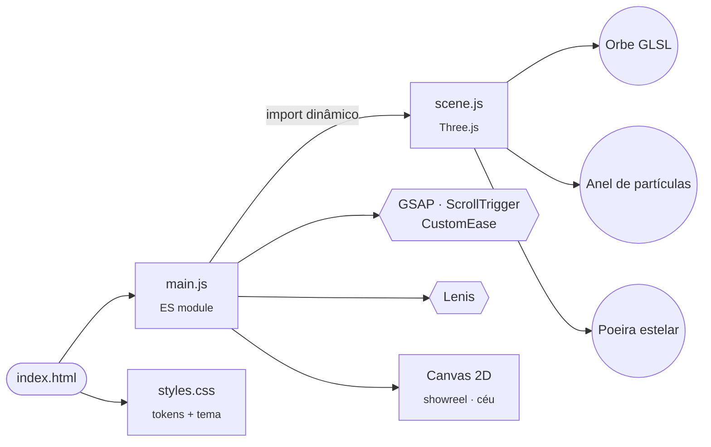

<details>
<summary><b>🪐 &nbsp;O orbe 3D</b></summary>
<br />

- `IcosahedronGeometry` com o vértice deslocado por **2 oitavas de simplex noise 3D**
- normais recalculadas por **diferenças finitas** no vertex shader, para uma iluminação suave sobre a superfície deformada
- fragment shader com rampa iridescente (índigo → coral → âmbar → lima), *fresnel*, especular Blinn-Phong e luz de recorte
- o cursor "puxa" a superfície; a rolagem aumenta a deformação, sobe o orbe e abre o anel
- a renderização pausa quando o herói sai da tela (`IntersectionObserver`)

</details>

<details>
<summary><b>⏳ &nbsp;A tela de carregamento</b></summary>
<br />

| Etapa | Peso |
|:--|:--:|
| Página (`load`) | **30%** |
| Fontes (`document.fonts.ready`) | **20%** |
| Cena 3D compilada | **50%** |

O contador avança de forma assintótica (nunca congela), dura no mínimo **1,6s** e é forçado a terminar em **6s**. A saída é uma cortina em `clip-path` que revela a câmera se aproximando do orbe.

</details>

<details>
<summary><b>🎞️ &nbsp;Linguagem de movimento</b></summary>
<br />

| Token | Curva | Origem |
|:--|:--|:--|
| `wipe` | `cubic-bezier(.76, 0, .24, 1)` | cortina do Squared Media |
| `radial` | `cubic-bezier(.25, .1, 0, 1)` | revelações do Squared Media |
| `soft` | `cubic-bezier(.52, 0, .48, 1)` | animações de entrada do Future Human |
| `expo.out` | padrão GSAP | títulos e cartões |

Revelação com desfoque inspirada no `surgir` do Mapa do Astro, e estrelas cadentes a cada 3–9s.

</details>

<details>
<summary><b>🎨 &nbsp;Design tokens</b></summary>
<br />

| | Nome | Hex |
|:--:|:--|:--|
|  | Obsidiana | `#050506` |
|  | Marfim | `#efe8dc` |
|  | Âmbar | `#e8a25c` |
|  | Coral | `#e5806a` |
|  | Lima elétrico | `#bafe02` |

**Tipografia:** [Plus Jakarta Sans](https://fonts.google.com/specimen/Plus+Jakarta+Sans) para títulos e textos · [Spectral](https://fonts.google.com/specimen/Spectral) *itálico* para os destaques · [Geist Mono](https://fonts.google.com/specimen/Geist+Mono) para os rótulos.

</details>

<br />

### Estrutura

```
nebula/
├── index.html      ← marcação, importmap e seções
├── styles.css      ← tokens, tema claro/escuro, layout responsivo
├── main.js         ← loader, rolagem, cursor, canvases, coreografia GSAP
├── scene.js        ← cena Three.js (orbe, anel, poeira) + shaders GLSL
├── fontes.html     ← comparação das opções tipográficas
└── assets/         ← banner e capturas deste README
```

<br />

## ✦ Rodando localmente

Não há build nem dependências: as bibliotecas vêm de CDN. Basta servir a pasta, porque os módulos ES não funcionam via `file://`.

```bash
npx http-server@14.1.1 -p 5173 -c-1
```

Depois abra **http://localhost:5173**.

<br />

## ✦ Deploy

[](https://vercel.com/new/clone?repository-url=https%3A%2F%2Fgithub.com%2Fgabrielnovaesdev%2FNebula)

Como o projeto é estático, use **Framework Preset → Other**, sem comando de build. Cada `git push` na `main` publica uma nova versão.

<br />

## ✦ Créditos

<table>
<tr>
<td valign="top" width="50%">

**Criação**
Gabriel Novaes ([@gabrielnovaesdev](https://github.com/gabrielnovaesdev))

</td>
<td valign="top" width="50%">

**Referências**
[Future Human](https://www.future-human.de/) ·
[Mapa do Astro](https://www.mapadoastro.com.br/) ·
[Squared Media](https://www.squared-media.nl/)

**Bibliotecas**
[Three.js](https://threejs.org/) · [GSAP](https://gsap.com/) · [Lenis](https://lenis.darkroom.engineering/)

</td>
</tr>
</table>

<br />

<div align="center">
<sub>Feito com poeira de estrelas em São Paulo &nbsp;✦&nbsp; 23°33′S · 46°38′O</sub>
</div>
